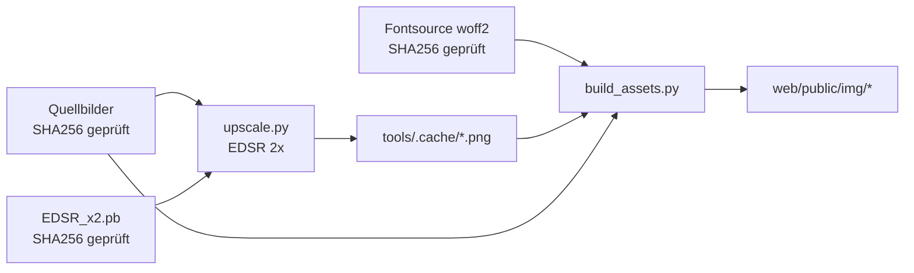

# Build: Bilder und Schriften

Alle Bilder in `web/public/img/` und alle Schriften in `web/public/fonts/`
entstehen per Skript, nie von Hand. Beide Ordner sind nicht im Repo
(Repo-Regel: keine Binärdateien), ebenso die Quellbilder.

```bash
tools/build.sh            # ~20 s mit Cache, sonst einmalig ~30 min CPU
tools/build.sh --clean    # Upscale-Cache verwerfen und neu rechnen
```

## Ablauf



1. **Quellen prüfen.** `build.sh` bricht ab, wenn eine Quelle fehlt oder ihr
   SHA256 abweicht; die Pixelkoordinaten in `build_assets.py` gelten nur für
   genau diese Dateien.
2. **venv.** `tools/.venv` mit Python 3.12 (uv), Versionen fest in
   `tools/requirements.txt`.
3. **Modell.** `EDSR_x2.pb` von GitHub (Saafke/EDSR_Tensorflow), SHA256
   `585623…d9b4`, liegt in `tools/models/`.
4. **Upscale.** `tools/upscale.py` rechnet beide Poster 2× hoch nach
   `tools/.cache/`. Vorhandene Ergebnisse werden übersprungen.
5. **Schriften.** Kalam 700 und Nunito (variabel, `wght` 200–1000), Latin-Subset,
   SIL OFL 1.1, aus Fontsource 5.3.0 über jsDelivr. Nur zur Build-Zeit; die
   Website liefert sie selbst aus.
6. **Assets.** `tools/build_assets.py` leert `web/public/img/` und erzeugt alles
   neu.

## Quellen (nicht im Repo)

| Datei | SHA256 | Herkunft |
|---|---|---|
| `quelle/ruhr-acro-convention-2027.jpg` (1403×1753) | `72c425…b571` | Original-Poster |
| `exporte/style1/WhatsApp Image 2026-10-27 at 12.48.16.jpeg` (900×1600) | `17e1eb…d9ba` | 9:16-Export für Phones |
| `exporte/timetable.jpeg` | `e6aba5…9e4f` | Zeitplan (nur Inhaltsquelle, nicht gebaut) |

Auf einem neuen Rechner diese Dateien an die Pfade kopieren, dann `tools/build.sh`.

## Ergebnisse

| Datei | Größe | Zweck |
|---|---|---|
| `art-4x5-{1400,2000,2806}.webp` | 205/297/432 KB | Poster-Hero Tablet/Desktop, Text aus Pinseln entfernt |
| `art-9x16-{800,1200,1800}.webp` | 131/207/317 KB | Poster-Hero Phone |
| `medal-{workshops,community,jams}.webp` | je ~10 KB | Icons im Angebot |
| `lotus.webp` | klein | Ornament |
| `social-1200x630.jpg` | 140 KB | `og:image`, Twitter-Card |
| `event-{1x1,4x3,16x9}.jpg` | 255/257/225 KB | JSON-LD `Event.image` (Google: 3 Formate, ≥ 720 px) |
| `favicon.png`, `touch-icon.png` | 2/15 KB | Icons |

Share- und Event-Bilder sind JPEG, weil einige Social-Crawler WebP ignorieren.
Sie zeigen das unveränderte Original-Poster (Event-Bilder: ganzes Poster mittig
auf Nachtgrün, nichts beschnitten).

## Reproduzierbarkeit (geprüft 2026-10-27)

- `build_assets.py` zweimal hintereinander: byte-identische Ausgabe.
- EDSR zweimal: identisch; gegen den alten Cache max. 1 Graustufe Abweichung
  (Tiling).
- Schriften nach Löschen neu geladen: byte-identisch zur vorherigen Version.
- Favicon unterscheidet sich zwischen altem System-Python und gepinntem venv
  (Pillow-Version) – deshalb nur noch über `build.sh` bauen.

## Wenn sich Quellen ändern

Neues Poster oder neuer Export: Boxen in `build_assets.py` neu vermessen (1×
Quellpixel), SHA256 in `build.sh` aktualisieren und die Overlay-Positionen in
`web/public/assets/site.css` anpassen:
`--place-y`/`--date-y`/`--stage-y` = Poster-y ÷ Poster-Breite × 100 (`cqw`),
jeweils für 4:5 und 9:16 **und** im `@supports not (width: 1cqw)`-Fallback.
