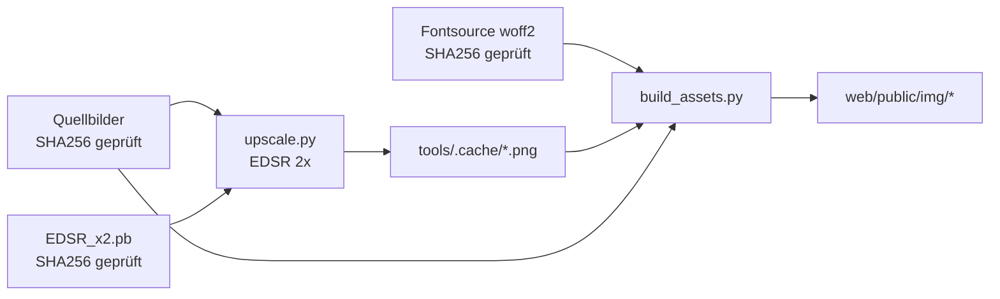

# Build: Bilder und Schriften

Alle Bilder in `web/public/img/` und alle Schriften in `web/public/fonts/`
entstehen per Skript, nie von Hand. Beide Ordner sind nicht im Repo
(Repo-Regel: keine Binärdateien), ebenso die Quellbilder.

```bash
tools/build.sh            # ~20 s mit Cache, sonst einmalig ~30 min CPU
tools/build.sh --clean    # Upscale-Cache verwerfen und neu rechnen
```

## Ablauf



1. **Quellen prüfen.** `build.sh` bricht ab, wenn eine Quelle fehlt oder ihr
   SHA256 abweicht; die Pixelkoordinaten in `build_assets.py` gelten nur für
   genau diese Dateien.
2. **venv.** `tools/.venv` mit Python 3.12 (uv), Versionen fest in
   `tools/requirements.txt`.
3. **Modell.** `EDSR_x2.pb` von GitHub (Saafke/EDSR_Tensorflow), SHA256
   `585623…d9b4`, liegt in `tools/models/`.
4. **Upscale.** `tools/upscale.py` rechnet beide Poster 2× hoch nach
   `tools/.cache/`. Vorhandene Ergebnisse werden übersprungen.
5. **Schriften.** Kalam 700 und Nunito (variabel, `wght` 200–1000), Latin-Subset,
   SIL OFL 1.1, aus Fontsource 5.3.0 über jsDelivr. Nur zur Build-Zeit; die
   Website liefert sie selbst aus.
6. **Assets.** `tools/build_assets.py` leert `web/public/img/` und erzeugt alles
   neu.

## Quellen (nicht im Repo)

| Datei | SHA256 | Herkunft |
|---|---|---|
| `quelle/ruhr-acro-convention-2027.jpg` (1403×1753) | `72c425…b571` | Original-Poster |
| `exporte/style1/WhatsApp Image 2026-10-27 at 12.48.16.jpeg` (900×1600) | `17e1eb…d9ba` | 9:16-Export für Phones |
| `exporte/timetable.jpeg` | `e6aba5…9e4f` | Zeitplan (nur Inhaltsquelle, nicht gebaut) |

Auf einem neuen Rechner diese Dateien an die Pfade kopieren, dann `tools/build.sh`.

## Ergebnisse

| Datei | Größe | Zweck |
|---|---|---|
| `art-4x5-{1400,2000,2806}.webp` | 205/297/432 KB | Poster-Hero Tablet/Desktop, Text aus Pinseln entfernt |
| `art-9x16-{800,1200,1800}.webp` | 131/207/317 KB | Poster-Hero Phone |
| `head-{1600,2600,4000,6173}.{avif,webp}` | AVIF 42/79/130/209 KB, WebP 55/103/167/280 KB | Redesign: Header-Band (Szene ohne Schrift), siehe unten |
| `foot-{1600,2600,4000,6173}.{avif,webp}` | AVIF 14/25/40/69 KB, WebP 19/33/55/96 KB | Redesign: Footer-Band (Pflanzen) |
| `medal-{workshops,community,jams}.webp` | je ~10 KB | Icons im Angebot |
| `lotus.webp` | klein | Ornament |
| `social-1200x630.jpg` | 140 KB | `og:image`, Twitter-Card |
| `event-{1x1,4x3,16x9}.jpg` | 255/257/225 KB | JSON-LD `Event.image` (Google: 3 Formate, ≥ 720 px) |
| `favicon.png`, `touch-icon.png` | 2/15 KB | Icons |

Share- und Event-Bilder sind JPEG, weil einige Social-Crawler WebP ignorieren.
Sie zeigen das unveränderte Original-Poster (Event-Bilder: ganzes Poster mittig
auf Nachtgrün, nichts beschnitten).

### Header- und Footer-Band (Design `scene`)

Aufbau jeder Seite im Design `scene` ([architektur.md](architektur.md)):
Navigation, Header-Band, Inhalt auf Nachtgrün `#001913` (beliebig lang),
Footer mit Pflanzen-Band (steht bei wenig Inhalt am unteren Rand). Markup:
`band()` in `web/lib/render.php`, Geometrie: `web/public/assets/scene.css`.

- **Header** `HEAD` = (0, 376, 1403, 1095) in 1×-Pixeln: knapp über der Sonne
  (Oberkante y ≈ 385) bis unter die Akrobaten. Der „Essen“-Pinsel (ab y = 1043)
  wird zu einem weichen Schatten, darunter Übergang in Nachtgrün.
- **Footer** `FOOT` = (0, 1260, 1403, 1753): die unteren Pflanzen mit ganzen
  Zweigen, die über einen langen Verlauf aus dem Nachtgrün wachsen. Medaillons,
  Beschriftungen, Pinsel und Lotus in der Mitte werden zu Nachtgrün.
- **Seiten:** Jedes Band trägt links und rechts 0,6 × Kernbreite eingebackenen
  Farbüberlauf: nahe am Kern gespiegelt, weiter außen läuft die Randfarbe weiter;
  die Unschärfe beginnt 6 % innerhalb des Kerns und wächst nach außen, damit
  keine Kante zwischen scharf und unscharf sichtbar ist. Im Header beginnt der
  Verlauf ins Nachtgrün an den Seiten bis zu 120 Zeilen früher.
- **Spalte (CSS):** Kernbreite = `min(100 % − 2 × min(200px, 14 %), 50vh × 2806/1438)`,
  gleich für beide Bänder. Der Header ist damit höchstens halb so hoch wie das
  Fenster; er wird gleichmäßig verkleinert (nicht beschnitten, nicht verzerrt),
  der Farbüberlauf füllt die breiteren Seiten. `object-fit: cover` legt den
  Kern exakt auf die Spalte, solange das Fenster höchstens 2,2 × so breit ist
  wie die Spalte.
- **Nahtstellen:** Unterkante Header und Oberkante Footer sind nach dem
  Komprimieren höchstens 3 Stufen von `#001913` entfernt.

Posterpixel aus der EDSR-2×-Fassung ohne Farbkorrektur; verändert sind nur die
äußeren 6 % des Kerns (Unschärfe-Anlauf), der Pinsel und die Verläufe ins
Nachtgrün – die Akrobaten bleiben unberührt. AVIF mit 4:4:4, damit die goldenen
Lichtkanten an den dunklen
Figuren scharf bleiben; WebP als Fallback.

Formatvergleich am 2026-10-27 (Szenen-Ausschnitt gegen das Original):

| Variante | Größe | SSIM | Farbabweichung ΔE (Mittel) |
|---|---|---|---|
| AVIF q75 4:4:4 aus EDSR 2× | 190 KB | 0,994 | 1,46 |
| WebP q90 aus EDSR 2× | 240 KB | 0,993 | 1,54 |
| SVG (vtracer, feinste Stufe) | 928 KB (Brotli) | 0,93 | – |

SVG verworfen: Die Vektorisierung fasst die Schattierungen in Gesichtern und
Körpern zu Flächen zusammen, Konturen werden stufig – genau Kontrast und
Schatten an den Figuren gehen verloren, bei fünffacher Dateigröße. ΔE < 2,3
gilt als nicht wahrnehmbar.

## Reproduzierbarkeit (geprüft 2026-10-27)

- `build_assets.py` zweimal hintereinander: byte-identische Ausgabe.
- EDSR zweimal: identisch; gegen den alten Cache max. 1 Graustufe Abweichung
  (Tiling).
- Schriften nach Löschen neu geladen: byte-identisch zur vorherigen Version.
- Favicon unterscheidet sich zwischen altem System-Python und gepinntem venv
  (Pillow-Version) – deshalb nur noch über `build.sh` bauen.

## Wenn sich Quellen ändern

Neues Poster oder neuer Export: Boxen in `build_assets.py` neu vermessen (1×
Quellpixel), SHA256 in `build.sh` aktualisieren und die Overlay-Positionen in
`web/public/assets/site.css` anpassen:
`--place-y`/`--date-y`/`--stage-y` = Poster-y ÷ Poster-Breite × 100 (`cqw`),
jeweils für 4:5 und 9:16 **und** im `@supports not (width: 1cqw)`-Fallback.
